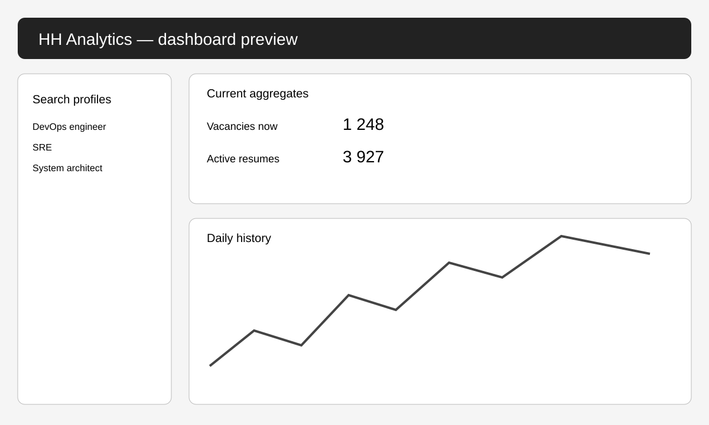
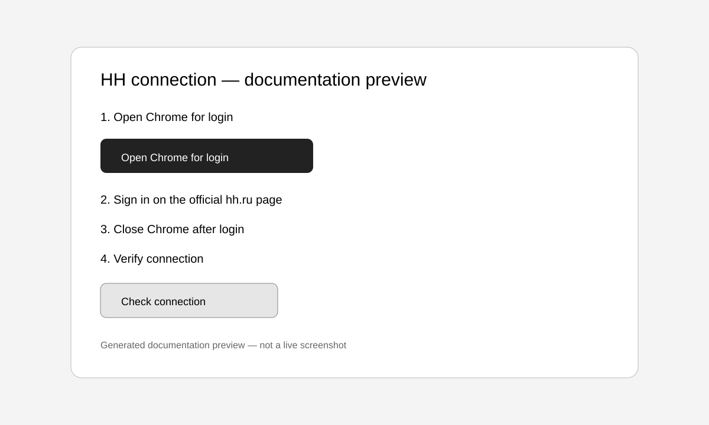

# analitikhhru — браузерная аналитика HH

Локальная веб-панель собирает **только агрегированные количества** вакансий и резюме с поисковых страниц hh.ru через установленный Google Chrome или Microsoft Edge.

API-приложение, Client ID, Client Secret и OAuth-токен не требуются.

## Как устроен вход

Программа не получает логин и пароль. Она открывает отдельный профиль Chrome в папке:

```text
data\hh-browser-profile
```

Пользователь сам вводит логин, пароль, код подтверждения и капчу только на официальной странице `hh.ru`. После закрытия браузера cookies остаются локально в профиле проекта.

## Быстрый запуск Windows

В PowerShell:
powershell -ExecutionPolicy Bypass
```powershell
cd F:\myprojekt\analitikhhru
.\start.cmd
```

При первом запуске `start.cmd`:

1. найдёт `uv`;
2. найдёт Python 3.12;
3. создаст `.venv` в папке проекта;
4. установит Flask, Playwright и остальные зависимости;
5. откроет панель `http://127.0.0.1:5050`.

Все пути вычисляются относительно папки проекта. Проект можно переносить на другой диск или в другую папку.

## Первый вход в HH

В панели нажмите **«Подключение HH»**, затем:

1. нажмите **«Открыть Chrome для входа»**;
2. войдите в `hh.ru` в открывшемся окне;
3. пройдите код или капчу вручную, если HH попросит;
4. полностью закройте открытое окно Chrome;
5. вернитесь в панель и нажмите **«Проверить подключение»**;
6. нажмите **«Обновить данные»**.

Отдельная команда для входа:

```powershell
.\login_hh.cmd
```

## Что собирается

Для каждой позиции из `searches.json`:

- активные вакансии сейчас;
- вакансии, опубликованные за 30 дней;
- резюме со статусом активного поиска;
- активные резюме за 30 дней;
- отношение резюме к вакансиям;
- история ежедневных замеров.

По умолчанию отслеживаются:

- DevOps-инженер;
- SRE / Site Reliability Engineer;
- ведущий системный администратор 1С;
- инфраструктурный архитектор;
- системный архитектор;
- руководитель IT-инфраструктуры.

## Одна программа, один запуск

Flask обслуживает и сервер, и интерфейс. React/Node.js отдельно запускать не требуется.

```powershell
.\start.cmd
```

Остановить сервер: `Ctrl+C`.

## Дополнительные команды

Проверить браузерную сессию:

```powershell
.\diagnose.cmd
```

Собрать данные без открытия панели:

```powershell
.\collect.cmd
```

Первоначальная установка или обновление зависимостей:

```powershell
.\setup.cmd
```

## Файлы результатов

```text
data\hh_market.sqlite3
data\hh_market.csv
```

При ошибке страницы сохраняются для диагностики:

```text
data\browser-errors\*.png
data\browser-errors\*.html
```

## Важные ограничения

- программа не обходит капчу, 2FA и ограничения HH;
- при появлении проверки откройте Chrome для входа и пройдите её вручную;
- если HH изменит разметку поисковой страницы, может потребоваться обновить селекторы;
- сохраняются агрегированные числа, а не ФИО, контакты или тексты резюме;
- результаты разных поисковых фраз могут пересекаться, поэтому общие суммы не равны числу уникальных кандидатов или вакансий.

## Настройка браузера

По умолчанию используется Google Chrome:

```dotenv
HH_BROWSER_CHANNEL=chrome
```

Для Microsoft Edge:

```dotenv
HH_BROWSER_CHANNEL=msedge
```

Файл `.env` создаётся автоматически при первом запуске.
## Показатели STOCK и FLOW

В панели и CSV используются два разных коэффициента конкуренции:

- **STOCK** = активные резюме / активные вакансии. Показывает конкуренцию в текущем запасе рынка.
- **FLOW** = новые резюме за 30 дней / новые вакансии за 30 дней. Показывает конкуренцию среди новых публикаций за период.

CSV `data\hh_market.csv` теперь имеет русские понятные заголовки и сохраняется в UTF-8 с BOM и разделителем `;`, чтобы корректно открываться в русской версии Excel.


## Recruiting-support: наблюдаемые и модельные показатели

Версия 1.9.0 больше не выдаёт открытые вакансии рекрутеров за фактическую «силу поиска».
Опубликованная вакансия рекрутера означает незакрытый спрос на recruiting-ресурс, а не уже
работающего специалиста. Поэтому панель разделяет показатели на два слоя.

### Наблюдаемый слой

```text
HR Density = 1000 × открытые вакансии IT-рекрутеров / открытые IT-вакансии выборки
```

`HR Density` показывает число опубликованных вакансий IT-рекрутеров на 1 000 IT-вакансий.
Это прямой показатель из доступных counts без предположения о числе работающих рекрутеров.

После накопления минимум пяти замеров рассчитывается исторически нормированный показатель:

```text
OBS pressure = percentile rank(HR Density) в скользящем окне 365 дней
OBS support = 100 − OBS pressure
```

OBS сравнивает текущую HR-плотность только с собственной историей панели. Высокий OBS означает,
что видимый спрос на новых рекрутеров ниже большинства предыдущих замеров. Это не доказательство
высокой фактической укомплектованности.

### Сценарный proxy-слой

`K` — гипотеза об одновременной нагрузке: сколько открытых IT-позиций ведёт один рекрутер.
Основные сценарии: `20 / 25 / 30 / 40`; базовый — `25`. Значения `60 / 100 / 300` оставлены
для mass-hiring, автоматизированных и legacy-сравнений.

```text
Требуемые рекрутеры(K) = IT-вакансии / K
Posted pressure(K) = открытые HR-вакансии / требуемые рекрутеры(K)
Proxy support(K) = 100 / (1 + posted pressure(K))
Proxy deficit(K) = 100 − proxy support(K)
```

Эти индексы всегда подписаны как `proxy`. Они измеряют posted HR-demand относительно сценарной
потребности, но не staffed capacity. Истинный индекс обеспеченности потребовал бы `W` — оценки
числа реально работающих IT-рекрутеров:

```text
True capacity(K, W) = 100 × min(1; W / (IT-вакансии / K))
```

Пока `W` отсутствует, панель честно показывает `н/д`.

## Сравнительный график пульса

График переключается между всей IT-выборкой и HR / IT-рекрутингом и поддерживает периоды
`24 часа / 7 дней / всё время`. На общей относительной шкале сравниваются вакансии, резюме,
STOCK, FLOW, HR Density, OBS и сценарный PROXY. Первый доступный замер выбранного периода
принимается за 100; исходные значения доступны при наведении.

Корреляционный блок по умолчанию использует коэффициент Спирмена, дополнительно доступен
Пирсон. Можно проверить лаг `0 / 7 / 14 / 30 дней`. Корреляция не доказывает причинную связь,
а при короткой истории остаётся нестабильной.

## Почему базовый K равен 25

Публичные отраслевые ориентиры нельзя смешивать напрямую: одни источники измеряют одновременно
открытые requisitions, другие — месячный throughput, applications per hire или hires per recruiter.
Для сложного IT стартовая зона `20–30` выглядит реалистичнее прежних `100–300`, а `40` используется
как стрессовый сценарий. Значение K должно калиброваться по собственной истории time-to-fill,
конверсиям и сложности ролей.

Источники методологии:

- SHRM — How Many Open Reqs Should In-House Recruiters Have?
- SHRM — How do I determine an appropriate recruiter workload?
- Gem — 2025 Recruiting Benchmarks
- SmartRecruiters — Technology Benchmark Recruiting Metrics 2025
- Ashby — Recruiter Productivity, 2026 Talent Trends Report
- Greenhouse — Hiring Benchmarks 2026

## Хранение и пересчёт истории

Сырые counts в SQLite сохраняются. При запуске и смене K пересчитываются только производные
показатели. Старые столбцы `search_force_index` и `search_resource_deficit_index` сохранены как
совместимые aliases новых proxy-полей, поэтому прежняя база мигрирует без удаления истории.

## Contact / Контакты

- Email: [feudor.lab@yandex.ru](mailto:feudor.lab@yandex.ru)
- Telegram: [@Feudorlab1](https://t.me/Feudorlab1)

## Languages / Языки

[English](README_EN.md) · [Русский](README_RU.md) · [हिन्दी](README_HI.md) · [简体中文](README_ZH-CN.md) · [Қазақша](README_KK.md) · [Монгол](README_MN.md) · [Саха тыла](README_SAH.md) · [Беларуская](README_BE.md) · [한국어](README_KO.md)

## UI previews / Превью интерфейса





> These are generated documentation previews, not live screenshots. / Это сгенерированные превью документации, а не снимки работающей сессии.
