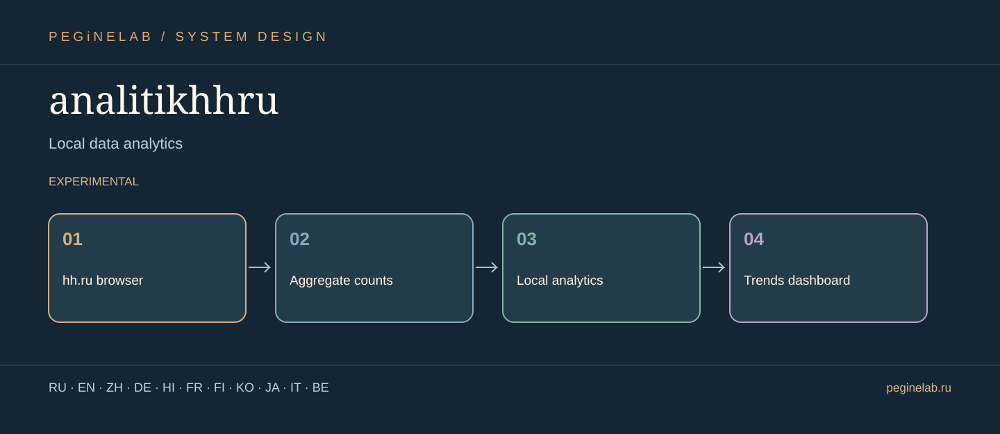

# analitikhhru — Visual project presentation

**Локальная аналитика данных · Local data analytics**

**Project flow:** hh.ru browser → Aggregate counts → Local analytics → Trends dashboard. **Status:** experimental.

**Translations:** documentation showcase only; interface localization and actual device tests are described independently in this project's README.

### Русский · ru
Анализ агрегированных вакансий и резюме hh.ru в локальной панели.. **analitikhhru:** hh.ru browser → Aggregate counts → Local analytics → Trends dashboard.

### English · en
Local dashboard for aggregate hh.ru vacancies and résumés.. **analitikhhru:** hh.ru browser → Aggregate counts → Local analytics → Trends dashboard.

### 简体中文 · zh
用于 hh.ru 职位与简历汇总分析的本地面板。. **analitikhhru:** hh.ru browser → Aggregate counts → Local analytics → Trends dashboard.

### Deutsch · de
Lokales Dashboard für aggregierte hh.ru-Stellen und Lebensläufe.. **analitikhhru:** hh.ru browser → Aggregate counts → Local analytics → Trends dashboard.

### हिन्दी · hi
hh.ru नौकरी और रिज़्यूमे आँकड़ों के लिए स्थानीय डैशबोर्ड।. **analitikhhru:** hh.ru browser → Aggregate counts → Local analytics → Trends dashboard.

### Français · fr
Tableau de bord local pour offres et CV agrégés de hh.ru.. **analitikhhru:** hh.ru browser → Aggregate counts → Local analytics → Trends dashboard.

### Suomi · fi
Paikallinen hallintapaneeli hh.ru-työpaikkojen ja ansioluetteloiden koosteille.. **analitikhhru:** hh.ru browser → Aggregate counts → Local analytics → Trends dashboard.

### 한국어 · ko
hh.ru 채용공고와 이력서 집계용 로컬 대시보드.. **analitikhhru:** hh.ru browser → Aggregate counts → Local analytics → Trends dashboard.

### 日本語 · ja
ローカルデータ分析. **analitikhhru:** hh.ru browser → Aggregate counts → Local analytics → Trends dashboard.

### Italiano · it
Analisi locale dei dati. **analitikhhru:** hh.ru browser → Aggregate counts → Local analytics → Trends dashboard.

### Беларуская · be
Лакальная аналітыка даных. **analitikhhru:** hh.ru browser → Aggregate counts → Local analytics → Trends dashboard.

## Контакты / Contact

Telegram: [@Feudorlab1](https://t.me/Feudorlab1) · Phone: [+7 926 041 1145](tel:+79260411145)

Email: [feudor.lab@yandex.ru](mailto:feudor.lab@yandex.ru), [obzorniky@gmail.com](mailto:obzorniky@gmail.com) · [peginelab.ru](https://peginelab.ru/)

[Repository](https://github.com/musikfed/analitikhhru) · Technical README is authoritative; experimental features are not certified.
